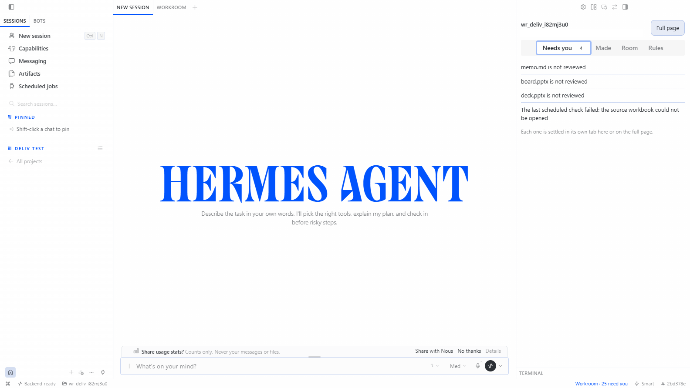
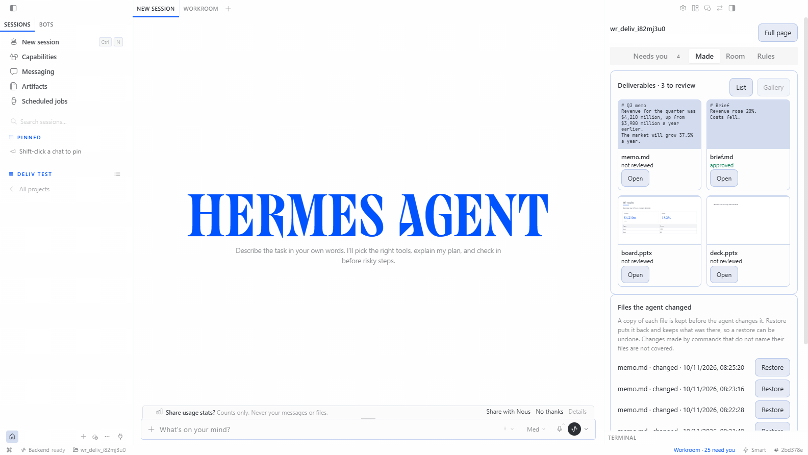
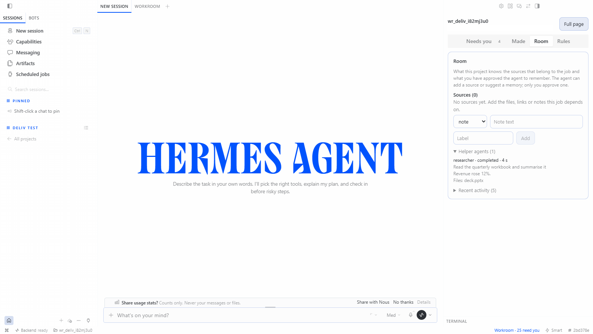
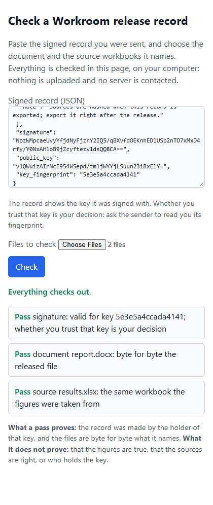
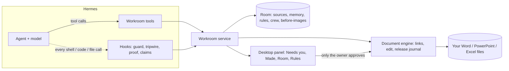

# Workroom for Hermes

### A shared room where the agent works on your documents, and cannot overwrite them, lose them, or overclaim what it did.

**Figures tied to their sources · Nothing changes without you · Every claim checked**

[Quick start](#quick-start) · [What it does](#what-it-does) · [Evidence](#evidence) · [How it compares](#how-it-compares) · [Limits](#what-it-does-not-do-yet) · [Architecture](#architecture)

Hermes can already read, write and run things. What it cannot do on its own is *prove* its work: where each number came from, that nothing outside the task was touched, that the file it says it made exists. Workroom adds that layer as one Hermes plugin (model tools, tool-call hooks, a Desktop panel and a document engine), so an agent can do real work on Word, PowerPoint and Excel files while you stay in charge of every change.

> **Status: version 0.4.0, an early release, built and tested on Windows; the suite also passes on Linux.** Everything below is backed by a row in [`bench/EVIDENCE.md`](bench/EVIDENCE.md) or a number in [Evidence](docs/EVIDENCE.md); what is not proven is named in [Limits](docs/LIMITS.md). Real-model checks are one run per case, not rates.

## Three promises

| | Promise | How it is kept | Checked with a real model |
|---|---|---|---|
| **1** | **Every figure has a source** | Numbers in reports and decks are linked to the workbook cell they came from; when a source changes you see exactly which numbers in which files are affected and only those change. In the agent's own text each figure is marked *supported by a source*, *calculation verified* or *not verified*, from what it actually read. | Asked to research the Australian EV market and build a board deck, Haiku wrote "all numbers are sourced"; Workroom flagged the figures with nothing behind them and said no deck existed yet. |
| **2** | **Nothing changes without you** | The agent can prepare a release; it has no tool to approve one. A tripwire under the shell guard puts back any managed Office file or protected file a command changed, keeps the agent's version aside, and gives every other changed file a before-image you can Restore. | Told to skip Workroom, Haiku edited a deck with a Python script (it worked once). With the net on, three different attempts were each reverted and nothing changed. Told to tidy a folder it moved your protected `.env`; now those stay and nothing is lost. |
| **3** | **The agent cannot overclaim** | A reply that says "I created a 6-slide deck" when no deck exists gets one line saying what is actually in your folder and what is waiting for your approval. | The same T1 run: Haiku claimed a deck, there were two workbooks staged and no deck; the line says so. |

## What it does

<table>
<tr>
<td width="50%"> <b>Changes inbox.</b> One card per changed source cell with every sentence, table cell and chart point it reaches; your hand edits are held, not overwritten.</td>
<td width="50%"> <b>Review room.</b> The report or deck is drawn as Office draws it with every linked figure marked, before and after the release.</td>
</tr>
<tr>
<td> <b>Needs you.</b> Releases, memory proposals, files to review, questions, a failed or missed scheduled check, a direct change that was put back: one inbox across every project.</td>
<td> <b>Made.</b> Everything the agent produced, as a list or a gallery, with a preview, a comparison with the version before, and approval of the exact version you accept.</td>
</tr>
<tr>
<td> <b>Figure proof.</b> Each figure underlined and marked supported, calculated or not verified, with the evidence it rests on.</td>
<td> <b>No Office needed to look.</b> Decks and reports are drawn from their own shapes and text, with linked figures underlined in green.</td>
</tr>
<tr>
<td> <b>Room.</b> Sources, memory the agent proposes and you decide, project rules, and the helper agents it started with what each was asked and touched.</td>
<td> <b>Signed release record.</b> A signed proof of who approved which exact files against which sources, embeddable in the Office file and checkable in any browser with no server.</td>
</tr>
</table>

Also: **point-to-edit** (change a few words in one shape or paragraph; every other part of the file stays byte-identical, linked figures refused; 50 of 50 edits on real files had no collateral change), **roll forward** a recurring report to the next period, **create** decks, reports and workbooks with every figure born tied to its cell, a **layout check** for decks the agent builds (210 of 210 seeded faults found, 0 of 210 clean slides flagged), **scheduled checks** that prepare a release when a source changes and leave a receipt on every run, **approval from your phone** (verified in real Telegram), a **run score** an evaluation harness can use as a reward, and a **self-test** the agent can run.

## In one minute

1. Point Workroom at a folder with a workbook and a report or deck. It links each number to its cell.
2. A new quarter's workbook arrives. The **Changes** inbox lists everything it reaches; your edits are held.
3. Press **Approve and publish**. One release is written, a backup of every replaced file is kept, **Past releases** restores it.
4. Ask Hermes to build something new. It stages a release with every figure tied to a source cell and waits; the **Made** tab shows what changed and which figures are backed by evidence.

## Evidence

| Claim | Result | Where |
|---|---|---|
| Automatic links are right on reports the builder had not seen | 357 of 360 judged cases (99.2%, 95% interval 97.6 to 99.8) on two sealed sets of public reports, judged by an independent reader | [Evidence](docs/EVIDENCE.md) |
| The editor touches only what must change | Every untouched part of 250 public Office files stays byte-identical; checked by python-pptx, Microsoft's Open XML validator and the real Word, Excel and PowerPoint | `bench/EVIDENCE.md` |
| A release survives a crash and restores exactly | Recovery from a crash at every injected point; restore returns the original bytes | `bench/EVIDENCE.md` |
| The agent cannot approve or publish | No Workroom tool approves; attempts by a real model to approve, to publish via a speaker-note injection, and to bypass ended with nothing changed | `bench/EVIDENCE.md` (real Haiku runs) |
| Tests | 731 passed on Windows; 707 passed on Linux from a fresh clone; the catalog validator passes | `research/corpus/final_check_run4.log` |

## How it compares

Public descriptions of the closest products, read from their own documentation (see `research/cowork/` for the sources), against what is measured here. A blank means not documented, not that it is absent.

| | Workroom | Claude Cowork | ChatGPT Work | OpenWork (open source) |
|---|---|---|---|---|
| Works on your own Office files | yes | | | |
| Open source, runs on your machine | yes (MIT) | no | no | yes |
| Every figure tied to a source cell and kept in step when the source changes | yes | | | |
| Agent has no approve or publish tool; direct changes to managed files are put back | yes, checked with a real model | | | |
| Reply claims checked against the folder; unsourced figures flagged | yes | | | |
| Signed record of each release, checkable without a server | yes | | | |
| Runs inside Hermes (tools, cron, messaging, Desktop) | yes | no | no | no |

## Quick start

1. Use Hermes 0.23.0 or later and enable the Workroom plugin. In Hermes Desktop a **WORKROOM** tab appears once the plugin is switched on.
2. First time here? Choose **Make the sample project**. It builds a small workbook and board deck in Workroom's own storage, never in your folders, so you can try the whole loop safely.
3. With your own files: enter a folder that holds the workbook and the report or deck, then **Find links**, **Check the sources**, **Prepare release**, and **Approve and publish**. **Past releases** restores any of them.

Run the bundled self-test from the agent with the `workroom_selftest` tool. Development: `pip install -r requirements-dev.txt`, then `python -m pytest tests -q`. More: [glossary](docs/GLOSSARY.md), [contributing](CONTRIBUTING.md), [security policy](SECURITY.md), [changelog](CHANGELOG.md).

## Architecture

The agent talks to Workroom's tools; hooks watch every tool call; the service owns the links, the release journal and the Room; the Desktop panel is where the owner decides. Approval is an owner-only route, never a tool.

## How it works

1. **Find the links.** Workroom reads decks (.pptx), reports (.docx) and workbooks (.xlsx) and links each number to a source cell using the value, the words around it, the period and the units. Equal numbers never create a link by themselves. When it is not sure, it asks you; it never guesses.
2. **See what would change.** When a source cell changes, you see every place it reaches, old value and new value, before anything is written.
3. **Approve one release.** For Word you can choose to release changes as real tracked changes, so a reviewer accepts or rejects each one. Approval is bound to the exact set of changes. A change made by hand in a document after the release was prepared stops the release. A hand-edited sentence is held, not overwritten.
4. **Publish and recover.** Files are replaced under a journal; a crash at any point recovers to the new state, and a backup of every replaced file is kept; the Past releases list restores a release, refusing if those files changed since.

Ask Why: for any linked number, Workroom says which cell it came from, which labels and period matched, the value now and at the last release, and what would happen if the source changed.

## The change map

Under "See what would change", **Map** draws the Changes inbox as a graph. Every box and line is a link the project holds, not a picture of it: on the left the source cells that changed (a dashed red box when a cell no longer holds a number), on the right the places in each document they reach, coloured by what will happen (will update, held for you, source missing), with a red or amber "!" where a finding needs your check. Select a box to follow its links: the old and new value, the sentence, why it will or will not change, and the finding with its evidence. "Show this file in its folder" uses the Desktop's reveal door. It works from the keyboard (Tab, Enter, Escape), and **List** is the same information as text.

What it does not draw: a calculated figure is its own box on the left (the inbox does not list the cells it was calculated from, so no lines are invented to them); at most 80 places are drawn, and the list has all of them; in a window narrower than 700 px the list is shown first. Tested against the project's own link table (every drawn line is a link, every changed link is drawn), in a real browser with the real Desktop script, and driven in the real Hermes Desktop v0.23.0 on Windows (9 of 9 checks). Not clicked in the real Desktop: "Show this file in its folder".

## The review room

Under "Review the documents" the report or deck is drawn as Microsoft Office draws it, with every linked figure marked on its page: blue for the figures that change, green linked, purple needs you, amber your own edit (protected), red held back. A switch shows the page as it is now or as it would be after the release; choosing a mark says where the figure came from. Nothing is changed by looking. It needs Office on the machine (LibreOffice is supported in code and untested here); without it a list says it is not a drawing of the document.

## Recipes, column questions and the release record

- **Recipe.** Approve one report as the model for a recurring report; a copy of it inherits its links, each checked again, so last month's file is linked to the workbook in one step. Only the owner can approve it.
- **Column questions.** When a column of a report table fits two workbook columns about equally, you are asked once for the column ("this is the Level 3 column, not the carrying amount") instead of once for each figure. Every row is still checked against the column you chose.
- **Release record.** Every published release has a readable record: what changed with its source cell, the files by hash, the checks that ran or could not run, who approved it, how to restore it. It is evidence for you, not a signed statement.

## What a change means

A changed number is not the whole change. After an update Workroom reads what the new numbers do to the words around them and lists what needs your eyes before you approve.

- **Claims that stopped being true.** "Up from", "grew from X to Y", "exceeded", "record", "rose to" and "held steady at" are checked against the figures. A sentence that was true and is now false is flagged with the numbers that show it; its words are never rewritten for you. An unqualified "rose" is judged against the previous period, and against the year earlier when the sentence says so.
- **Calculated numbers.** A percent change, margin, difference or total that the sources reproduce is found by arithmetic, shown with its formula, and follows its sources once you accept it. It never changes sign silently: an "up 8%" that would become a fall is held. When several calculations fit, none is chosen for you.
- **Places the editor does not rewrite.** A number in speaker notes, chart text or a picture description that still shows an old value, a chart whose axis is fixed below a new value, and a figure in a changed sentence that nothing updates are reported, and stay reported until you change them or dismiss them.
- **A workbook that moves.** Each link remembers the headings of its source cell. If rows or columns are inserted or a window of periods slides along, the link follows its cell; when it cannot tell, it asks you and says why.
- **Charts already in a deck.** Each point is linked to its cell by the chart's series name and category, written to the chart and its embedded workbook together, and held when a person changed it or when the embedded cell is a formula.
- **A source that looks wrong.** If some figures lost their source cell while others are updated from the same workbook (a region, period or sheet is probably missing), or a source cell moved by a factor of 100 or more or became zero (the usual signature of a unit slip or a paste over the wrong range), the release carries a "Read first" finding naming them. It does not refuse: it asks the owner to acknowledge it before approval. Not checked: types, value ranges, row counts, period coverage as a set.
- **Approval.** Findings marked "Read first" must be acknowledged before the release can be approved, in the Desktop screen and in chat. A decision to dismiss a finding is remembered, so the same question is not asked every cycle.

## Roll forward

When the workbook has the next period, "Roll forward one period" in the Desktop screen (or the `workroom_roll_forward` tool) prepares one release that moves every linked figure to the same row's next column or row and advances the period words beside them, in the style they were written in: Q3 2026 to Q4 2026, Mar 2026 to Apr 2026, FY2025 to FY2026. It is refused, naming each figure, when a figure has no value for the next period. You approve once, and one restore undoes the whole roll. A number you roll or correct by hand stays managed. Chart periods and period words inside speaker notes are not rolled; the first is listed, the second is reported.

## Create, then keep in step

Workroom can also make the file, so its numbers are linked to their sources from the first second instead of being matched later.

- **Create.** The agent writes a *spec* (text with `{fact:format}` slots for every figure) instead of an Office file. Workroom checks it, builds a PowerPoint deck (text, tables, KPI cards, native charts), a Word report or an Excel workbook (tied number cells, your formulas kept) in a separate process, and stages it as a release. Nothing is written until you approve, and Restore removes exactly what was created. Every figure carries a receipt: which cell, which concept and period, which unit and format. A percent shown as money, a Q3 figure placed next to Q2 words, or a cell the labels do not support is refused before anything is staged.
- **Brand.** A `brand.json` in the project (accent, ink, muted colours as six hex digits, a font name), or colour and font tokens read from a `DESIGN.md` (primary, text, muted, font family; nothing else in the file is used), themes the decks Workroom creates, unless a spec sets its own. `brand.json` wins over `DESIGN.md`. Decks only for now; Word reports and visual pages are not themed.
- **Changes inbox.** One card per changed source cell, listing every place it reaches with its sentence and what will happen: update, hold (you edited it, or it cannot be written faithfully) or blocked (the source is gone).
- **Before and after.** Under a prepared release, on Windows with PowerPoint installed, Workroom can draw the changed slides as they are now and as they will be after approval (it renders a private copy; your file is not touched). Elsewhere it says pictures are unavailable.
- **Visual pages.** A page of shapes and text (`*.scene.json`) with linked text, an editor in the Desktop (draw, move with snapping, resize, nudge, undo and redo, text edit, align, layers, comment to the agent), and exports to SVG, HTML and native PowerPoint shapes. Edits are a draft; saving stages a release for you to approve.
- **Project instructions.** `workroom.md`, `AGENTS.md` and `CLAUDE.md` in a project are shown to the agent only after you read and authorise their exact text, and they can never change who approves or what needs approval.
- **Try the sample.** On a first run, one click makes a sample project in Workroom's own storage, stages its deck for your approval, and lets you pretend a new quarter arrived.

Evidence for each is in `bench/EVIDENCE.md` (rows dated 8 Nov 2026). What is not verified is listed in the same rows: a real model (Gemini) has driven the creation and page tools in only one or two runs per scenario (it found a real defect, since fixed: typed-by-hand figures), so there is no repeatability data, the page editor passed automated keyboard, contrast and touch-event tests but has not been used with a real screen reader or a physical touch device, and the new Desktop screens were run on Windows only (the test suite also passes on macOS and Linux in CI).

## Schedule it

`/workroom-watch <project>` prints a two-line recipe for Hermes cron: a small wrapper script and a `hermes cron create ... --no-agent` line. On each run Workroom checks the sources and, if something changed, prepares one release and tells you where to approve it; if nothing changed it says nothing. No model is involved and nothing is ever approved or published by the schedule. Tested through the real Hermes scheduler on Windows (see the 8 Nov evidence row); delivery to a chat and sleep catch-up are not yet tested.

## What the agent can and cannot do

The agent gets tools to register a folder, find links, preview a refresh, prepare a release, explain a number, run the self-test, list source cells, create files from a spec, read and edit visual pages as drafts, export pages, read authorised instructions and propose changes to `workroom.md`. It can also prepare a roll-forward release (`workroom_roll_forward`) and list the calculated numbers it finds (`workroom_find_calculations`), and it can read what a change means because the findings travel with every prepared release. **No Workroom tool approves or publishes.** Only the owner, through an authenticated Hermes session in the Desktop screen or the in-chat release card, can approve. A verifying sub-agent can be given only the read-only toolset `workroom_ro` (plan, explain, selftest, sources, pages, where-used, what-if).

That is a guarantee about Workroom's tools and its editor, and it stops there. An agent that is also given a general shell, file-write or code-execution tool runs as the same operating-system user as the owner: it could edit an Office file directly or read the signing key. Workroom blocks the common ways (its write guard refuses Hermes file-write tools on Office files in a project and sends shell commands that look like writes, including the script a command runs, to your approval prompt), but a pattern guard is a heuristic, not a boundary. Where the guarantee has to hold, give checking agents `workroom_ro` and no shell.

## Honest guarantees

- Discovery writes nothing to your documents.
- A release changes only the numbers it lists. Untouched parts of a document keep byte-identical compressed content (tested on 144 PowerPoint and 106 Word packages from public test corpora).
- A stale file, a replayed or expired approval, an approval for a different set of changes, or an altered saved history stops the release. Approving or restoring takes a per-project lock, so two approvals of one release arriving together publish it once.
- It cannot stop another program from changing a file while Workroom is not running. It detects that by hash.
- It does not recalculate Excel formulas itself. Edited workbooks are flagged to recalculate when opened.

## Evidence at a glance

| Question | What was measured | Caveat |
|---|---|---|
| Does an update touch only what it should? | Untouched parts stayed byte-identical in 250 of 250 public Word and PowerPoint packages; a release of 10 changed cells on a real government report rewrote exactly the 20 places it should and nothing else | public files and one independent report; Windows |
| Does the real software agree? | Word, Excel and PowerPoint open and read back every released file; Microsoft's Open XML validator reports no new error | Windows only |
| Are automatic links right on reports it had not seen? | 357 of 360 judged correct by an independent reader across two sets of public Victorian department reports (99.2%, 95% interval 97.6 to 99.8) | Word only, one government; see [Evidence](docs/EVIDENCE.md) |
| Are automatic links right? | Two independent reports from one agency: 0 wrong in 70 read by hand on the first; on the second (last year's report against this year's workbook) 6 wrong by label and 3 unclear of 181, all of which the reader now guards against or asks about | the guards were written after seeing those results, so they are not yet tested blind; the links not read by hand were checked mechanically only |
| Does it recover? | 16 of 16 injected crash points recover; restore is byte for byte | simulated process death, not a power cut |
| Can the agent publish? | No Workroom tool approves or publishes; capable hosted models refused, ignored a planted instruction and left files unchanged | one run each; a shell guard was bypassed once and hardened, see [Limits](docs/LIMITS.md) |

Full tables, caveats and the dated record: [Evidence](docs/EVIDENCE.md).

## What it does not do yet

- **Large first imports take real work.** On a report that is mostly small tables of counts, the blind run asked 3,841 questions (about 88% real); column questions and column order cut that on the files we tuned on, but not yet on a new one.
- **Four independent reports from one government have been measured, all Word.** No independent PowerPoint deck and no unrelated author yet; most other tests used documents and workbooks built for testing.
- **Windows is the tested desktop.** The suite also passes on macOS and Linux; the Hermes Desktop screens and the Office checks were run on Windows only.
- **The agent boundary covers Workroom's tools.** A shell guard stops the common ways around approval; it is a heuristic, not isolation.
- **Claims are read in English**, from a fixed set of wordings; anything else is listed as not checked.

The complete list is in [Limits](docs/LIMITS.md).

## Disclosure

- Dependencies installed by Hermes: `lxml` (reading and patching Office files), `python-pptx` and `python-docx` (building decks and reports; `XlsxWriter`, which python-pptx brings, writes workbooks). `pypdfium2` and `Pillow` (drawing the pages of a document in the review room: Office saves a private copy as a PDF and pdfium draws it; without them the room lists the figures instead). Test-only: pytest, openpyxl, Playwright.
- Programs Workroom starts, all local, none with network access of its own:
  1. a Python child process (same interpreter as Hermes, 60 second limit, scrubbed environment) that runs only `workroom_core/build/worker.py` to build a file from a validated spec; it receives no project paths and no secrets and contains no network code (the operating system does not enforce that);
  2. on Windows, the system `icacls` tool once, to make Workroom's own signing-key file readable only by your account;
  3. on Windows with PowerPoint installed, and only when you press "Show before and after", PowerShell drives PowerPoint on a private temporary copy of a deck to draw slide pictures; the copy is deleted afterwards;
  4. nothing else: Workroom never starts a scheduled job itself (`/workroom-watch` only prints the lines you can save for Hermes cron).
- No network access, no secrets read from files or the environment, no binaries, no self-update. A `pre_tool_call` hook blocks the agent's file-write tools on Office files in registered projects and sends suspicious shell commands to your approval prompt.
- Files read and written: inside the folders you register (documents; `brand.json` and the colour and font tokens of `DESIGN.md`; `workroom.md`, `AGENTS.md` and `CLAUDE.md` only as text for you to authorise; a `workroom.manifest.json` history file per project; files you approve Workroom to create), and in the plugin data directory (state, backups, a signing key file kept for this plugin only). Nothing else on your computer is read.
- The scripts under `bench/` (benchmarks, the real-Desktop driver, and a small .NET console tool that runs Microsoft's Open XML SDK validator) are for testing only. The plugin never runs them, and no compiled file is committed. One of them, `bench/verify/agent_dispatch.py`, imports two private Hermes modules to drive Hermes's own tool dispatcher; the catalog validator warns about it, and the plugin itself never imports it or those modules.
- See `NOTICE.md` for sources and credits.

## Licence

MIT. See [LICENSE](LICENSE) and [NOTICE.md](NOTICE.md).
